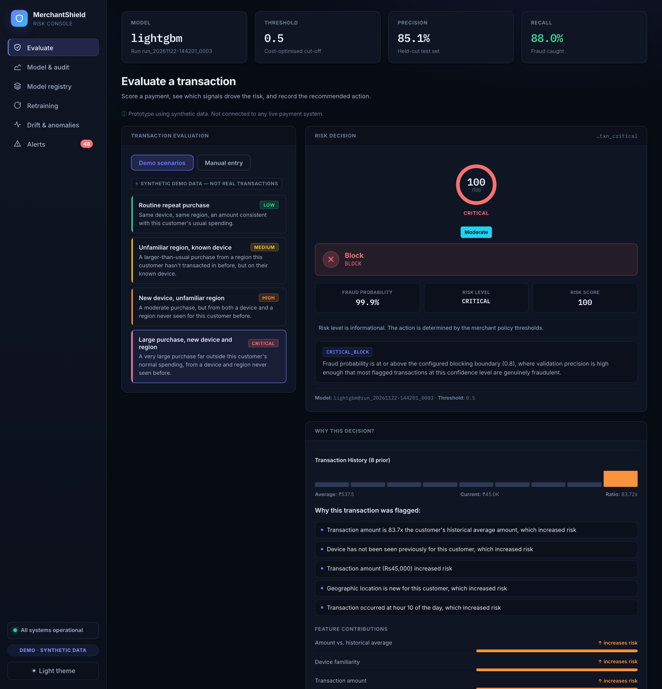
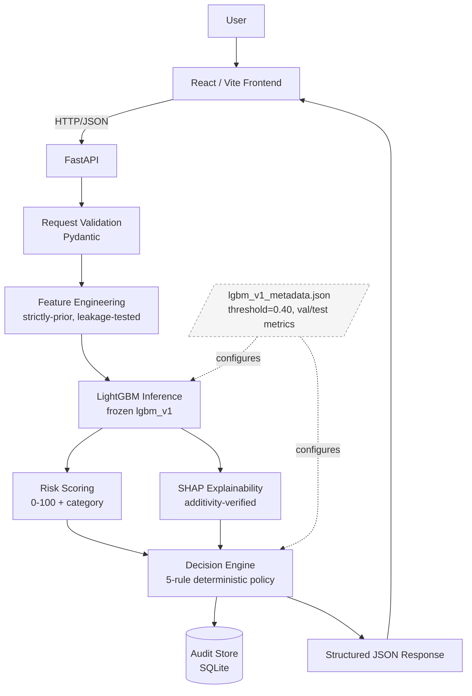
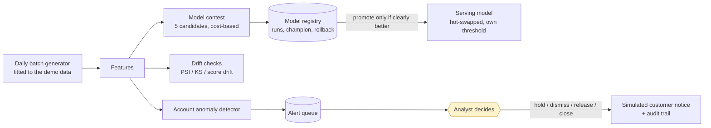
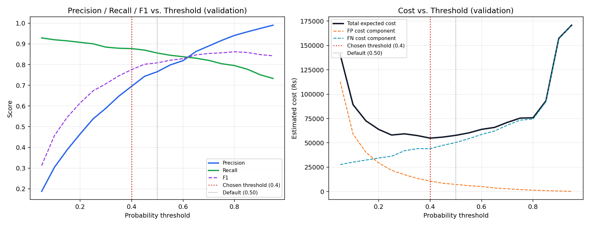
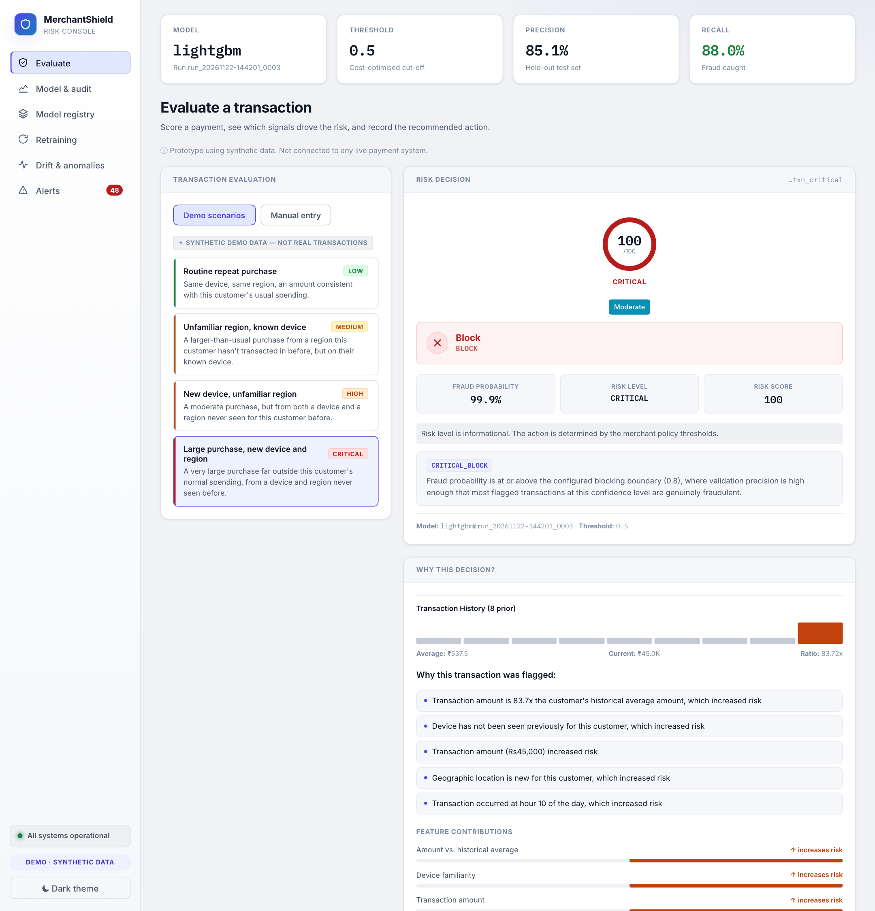
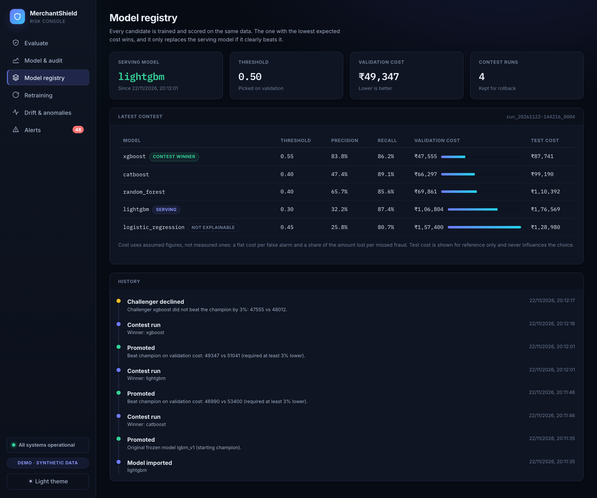
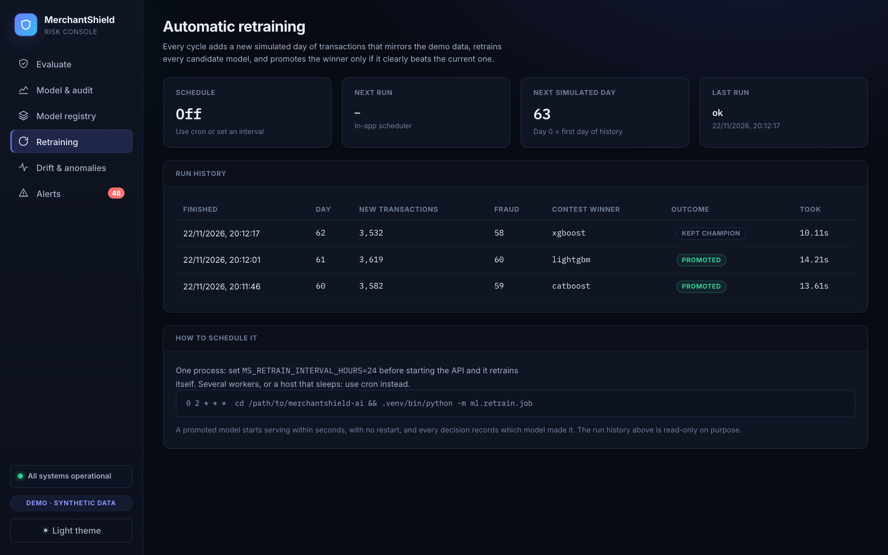
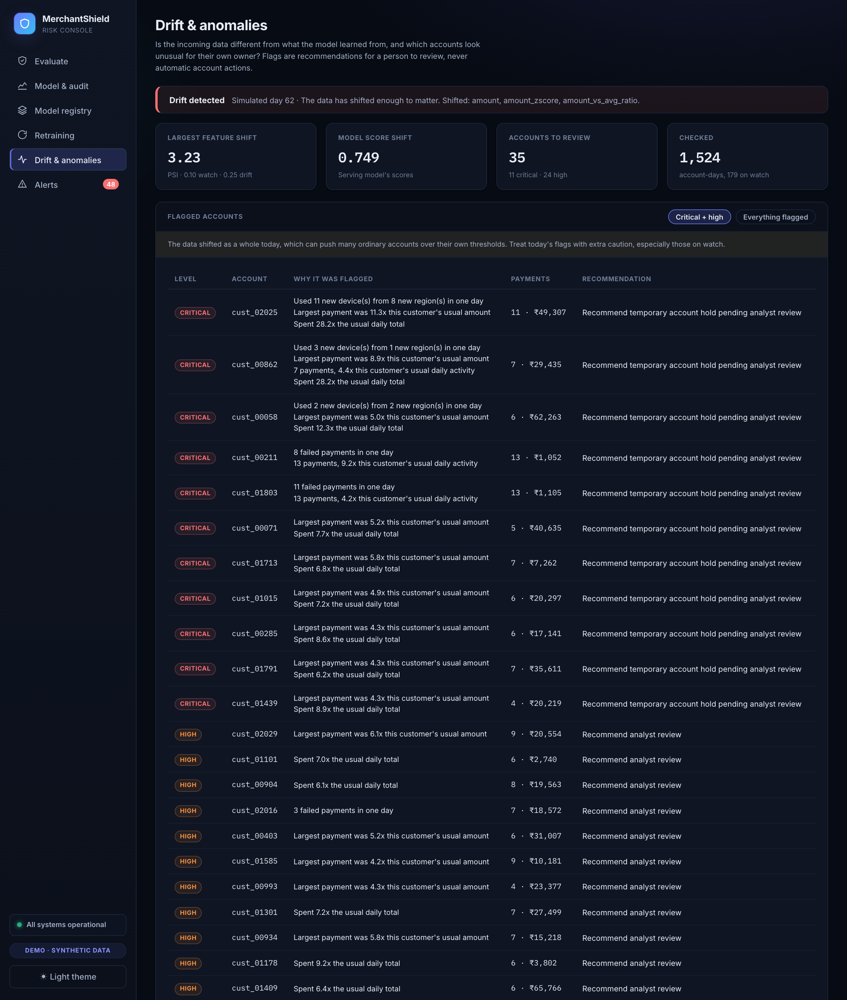
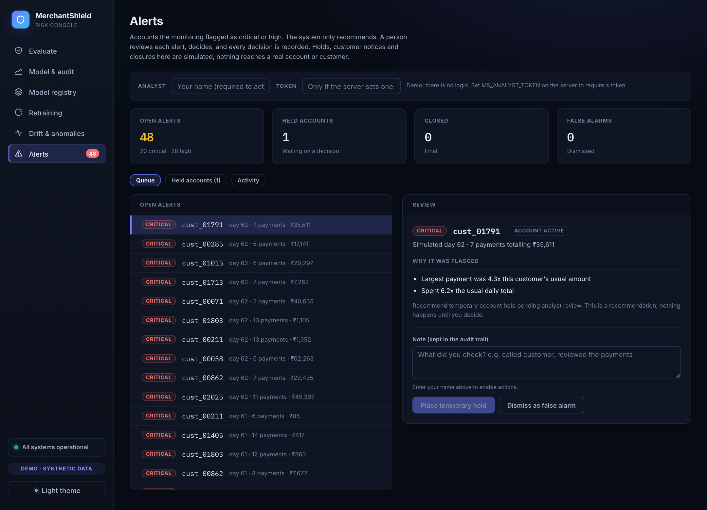

# MerchantShield AI

**An end-to-end explainable transaction-risk decisioning system.**

Given a payment transaction and its customer's recent history, MerchantShield estimates a
fraud probability with a trained model, explains that estimate with SHAP, and recommends a
bounded action (allow / monitor / step-up / block) using a transparent, rule-based policy —
never an irreversible financial action.

Around that core it runs a full model lifecycle: every day it generates fresh data, retrains
five competing models, promotes a winner only if it clearly beats the current one (and starts
serving it without a restart), watches the incoming data for drift, flags accounts that look
unusual for their own owner, and hands those flags to a human analyst who decides whether to
place a temporary hold. The system only ever recommends; people decide.

> **Scope.** A final-year project built on synthetic transaction data. Not connected to any real
> payment processor, account or customer: holds, closures and customer notices are simulated.
> There is no login (an optional shared token protects analyst actions) and it is not
> production-hardened. See [Limitations](#limitations--prototype-scope) and
> [External validation](#external-validation--ieee-cis) for what this means for the reported
> metrics.



## Quick start

Needs Python 3.11+ and Node.js 20.19+ or 22.12+.

```bash
python3 -m venv .venv && source .venv/bin/activate
pip install -r requirements.txt
python ml/data/generate_synthetic.py && python ml/features/build_features.py   # the data is not committed
(cd frontend && npm install && npm run build)
python -m uvicorn backend.main:app --port 8000        # dashboard and API at http://localhost:8000
```

To see the whole loop work, in a second terminal run two ordinary days and then one with an injected
spending shift (each takes about 20 seconds), then open the dashboard:

```bash
python -m ml.retrain.job
python -m ml.retrain.job
python -m ml.retrain.job --drift amount_scale=2.5
python -m ml.cases.ingest        # queue the flagged accounts for review
```

Then look at **Retraining**, **Model registry**, **Drift & anomalies** (the shift is caught and
attributed to the amount features) and **Alerts** (review a flagged account and place a simulated hold).

---

## Contents

[The problem](#the-problem) · [Key capabilities](#key-capabilities) ·
[Quick start](#quick-start) · [Architecture](#architecture) · [Tech stack](#tech-stack) · [Dataset](#dataset) ·
[ML pipeline](#ml-pipeline) · [Model results](#model--evaluation-results) ·
[Decision engine](#decision-engine) · [Explainability](#explainability) ·
[External validation](#external-validation--ieee-cis) ·
[Model contest](#model-contest-and-registry) · [Daily retraining](#daily-retraining) ·
[Public datasets](#real-public-datasets) ·
[Drift and anomalies](#drift-and-anomaly-monitoring) · [Alerts and holds](#alerts-and-account-holds) ·
[Audit trail](#audit-trail) · [API](#api) · [Frontend](#frontend--dashboard) ·
[Screenshots](#screenshots) · [Project structure](#project-structure) ·
[Local setup](#local-setup--running-the-project) ·
[Testing](#testing) · [Limitations](#limitations--prototype-scope)

---

## The problem

Fraud detection systems often fail rigorous scrutiny for three compounding reasons:
they report accuracy on a class-imbalanced dataset (meaningless at 1–3% fraud rates),
they pick a 0.5 classification threshold without cost justification, and they can't
explain a specific decision to a human reviewer. MerchantShield was built to address
all three simultaneously.

Beyond raw classification, real fraud systems need a *decisioning* layer: a model
probability of 0.45 does not answer "should we block this transaction?" — that depends
on the false-positive cost, the fraud amount, and business policy. MerchantShield
separates these concerns cleanly: the model estimates probability, a deterministic cost
function selects the threshold, and a separate rule-based policy converts probability
into a bounded, auditable action.

## Key capabilities

- **Leakage-safe feature engineering** — all 15 behavioural features are computed
  strictly from transactions before the one being scored; dedicated tests verify this
  property by re-running the feature computation for sampled customers and checking
  it matches the historical sequence exactly.
- **Cost-driven model selection and threshold** — three models compared on an explicit
  FP/FN cost function, not accuracy alone. The operating threshold (0.40) was chosen
  by sweeping thresholds against the cost model on a held-out validation set, then
  evaluated exactly once on the test set.
- **Grounded SHAP explainability** — every scored transaction gets a per-feature
  explanation derived from real SHAP values, with a mathematical additivity check
  (`base + Σshap ≈ predict_proba`) run on every call.
- **Deterministic, auditable decision policy** — a five-rule ordered table converts
  probability into one of four bounded actions. SHAP explanations are structurally
  incapable of influencing the action; this is enforced by the function signature and
  proven by a dedicated test.
- **REST API** — FastAPI with full input validation, structured error responses, model-
  unavailable graceful degradation, and an audit-write failure isolation layer.
- **React dashboard** — consumes only the documented API contract; never imports
  backend Python; SHAP contribution bars and verbatim action labels.
- **External validation** — the model and methodology were tested against the
  IEEE-CIS Fraud Detection dataset (real Vesta chargeback data). See
  [External validation](#external-validation--ieee-cis) for the honest results.
- **Model contest with guarded promotion** — LightGBM, XGBoost, CatBoost, random forest and
  logistic regression compete on the cost function; a winner replaces the serving model only if it
  is explainable and beats the incumbent by a margin, with a one-command rollback.
- **Daily automatic retraining** — a generator fitted to the demo data adds a new simulated day,
  models retrain on a rolling split, and a promoted model serves immediately with its own threshold.
- **Drift and anomaly monitoring** — PSI and KS drift tests (including on the model's own scores) and a
  per-account detector that judges each customer against their own norm, with plain-language reasons.
- **Human-in-the-loop alerts** — an analyst queue where only a named person can place a simulated
  hold, release or close an account, with customer notices and a full audit trail.
- **(V2) Historical transaction context** — optional prior transaction history enables
  behavioral pattern analysis; signal quality indicator (`MINIMAL`/`LIMITED`/`MODERATE`/`ESTABLISHED`)
  communicates confidence. Cold-start transactions explicitly flagged.
- **(V2) Model output hardening** — all model probabilities validated for finiteness and
  range; engineered features checked for pathological bounds (velocity spikes, extreme z-scores).
- **(V2) Idempotent schema migration** — audit persistence layer supports legacy database
  upgrades without data loss; prior_transaction_count column added safely to existing deployments.

## Architecture

```
Transaction + prior history
        │
        ▼
Pydantic validation (FastAPI)
        │
        ▼
Feature engineering — strictly-prior, leakage-tested (build_features.py)
        │
        ▼
LightGBM inference — frozen model artifact (lgbm_v1)
        │
        ├──────────────────────────────────┐
        ▼                                  ▼
Risk score / category              SHAP explanation
(0–100, deterministic mapping)     (grounded, additivity-verified)
        │                                  │
        └──────────────┬───────────────────┘
                       ▼
             Decision engine — 5-rule policy
             (probability + amount only; SHAP cannot influence action)
                       │
                       ├──▶ Audit persistence (SQLite)
                       │
                       ▼
             Structured JSON response
                       │
                       ▼
             React / Vite dashboard (HTTP/JSON only, no backend imports)
```



Three independently-auditable layers: the model estimates probability → a deterministic
module converts it to a 0–100 risk score for legibility → a separate deterministic
module decides the bounded action. Changing how risk is *displayed* can never silently
change what *action* is taken.

**Model lifecycle around it.** The scoring path above never changes by itself; this loop decides
what it serves and who gets alerted:



## Tech stack

| Layer | Technology |
|---|---|
| ML / data | Python, pandas, NumPy, scikit-learn, LightGBM, XGBoost, CatBoost, SHAP, scipy |
| Backend | FastAPI, Pydantic, SQLAlchemy + SQLite (audit), SQLite (alert queue), file-based model registry |
| Frontend | React 19, Vite, plain CSS (no UI framework), dark and light themes |
| Testing | pytest, FastAPI TestClient |
| Containerisation | Docker (multi-stage build), docker-compose |

No Kubernetes, no message queue, no extra services — deliberately minimal. All state is plain
files plus SQLite, which is why the app expects a single long-running server process.

## Dataset

The primary dataset is **synthetic and generator-controlled** — chosen so the
feature-engineering work is real and inspectable rather than operating on pre-
anonymized PCA columns. The generator and feature pipeline are separate processes
so fraud labels aren't trivially recoverable from the engineered features.

- ~213,000 transactions, 2,200 synthetic customers, 60-day window, ~1.5% fraud rate
- **Chronological split** (train: days 0–39, validation: 40–49, test: 50–59) —
  not random — to prevent leakage through time-aware velocity and behavioral features
- 15 engineered features (velocity windows, amount z-score, device/geo novelty,
  failed-transaction ratio, account age, time-of-day), each computed **strictly from
  prior transactions**, enforced by dedicated leakage tests

**No real payment data was used.** No Visa, Mastercard, or bank data.
All reported metrics are on this synthetic dataset unless explicitly labelled
[External validation](#external-validation--ieee-cis).

## ML pipeline

```
generate_synthetic.py        → ml/data/raw_transactions.csv
build_features.py            → ml/data/features.csv (15 leakage-safe features)
train_baseline.py            → Logistic Regression baseline + chronological_split utility
train_candidates.py          → LightGBM + Random Forest candidates, cost-based selection
threshold_analysis.py        → sweep thresholds on validation, freeze at cost minimum
risk_scoring.py              → probability → 0-100 score + LOW/MEDIUM/HIGH/CRITICAL
explainability.py            → SHAP TreeExplainer, additivity check, human-readable reasons
decision_engine.py + policy.py → 5-rule policy, ALLOWED_ACTIONS, audit record
```

All scripts are in `ml/` and are re-runnable. The frozen model artifact
(`ml/models/candidate_lgbm_v1.pkl`) and metadata (`ml/models/lgbm_v1_metadata.json`)
are committed so the API runs without retraining.

## Model & evaluation results

All numbers are on the **held-out test set** (days 50–59; never used during model
selection or threshold tuning). Comparison was based on validation-set expected cost,
not accuracy or ROC-AUC alone.

| Model | Precision | Recall | F1 | PR-AUC | FP | FN | Est. cost (test) |
|---|---|---|---|---|---|---|---|
| Logistic Regression (baseline) | 0.448 | 0.825 | 0.581 | 0.739 | 730 | 126 | ₹110,582 |
| Random Forest | 0.746 | 0.868 | 0.802 | 0.883 | 213 | 95 | ₹68,479 |
| **LightGBM (selected)** | **0.785** | **0.882** | **0.830** | 0.901 | 174 | 85 | **₹41,377** |

**Selected operating threshold: 0.40** — chosen by minimising expected cost on
validation (FP cost: ₹50 flat; FN cost: 0.5 × transaction amount) subject to a
minimum 80% fraud recall. Not the default 0.5; not the F1-maximising threshold (0.80,
which costs ~38% more under the asymmetric cost function).

The chart below is the actual precision/recall/F1 and estimated cost vs. threshold
sweep on the **validation set**:



Full threshold sweep, cost-sensitivity analysis, and all reproducible scripts are in
`ml/evaluation/threshold_analysis.py` and `ml/models/lgbm_v1_metadata.json`.

## Decision engine

A five-rule policy table converts a fraud probability (and transaction amount) into
a bounded action recommendation. Rules fire in order; first match wins.

| Rule | Condition | Action |
|---|---|---|
| `CRITICAL_BLOCK` | probability ≥ 0.80 | `BLOCK` |
| `HIGH_STEP_UP` | probability ≥ 0.40 | `STEP_UP_VERIFICATION` |
| `MEDIUM_AMOUNT_ESCALATION` | probability ≥ 0.15 and amount ≥ ₹25,000 | `STEP_UP_VERIFICATION` |
| `MEDIUM_MONITOR` | probability ≥ 0.15 | `ALLOW_WITH_MONITORING` |
| `LOW_ALLOW` | (catch-all) | `ALLOW` |

Every action is a **recommendation only** — the system cannot move money, freeze
accounts, or contact anyone. `ALLOW_WITH_MONITORING` is a policy label; no background
monitoring service exists in this prototype. `SHAP` explanations cannot influence the
action — `evaluate_policy()` accepts only `(probability, amount)`, enforced by
function signature and verified by dedicated tests. Full design rationale and all
boundary-condition tests are in [`docs/decision_engine.md`](docs/decision_engine.md).

## Explainability

Every `/risk/evaluate` call returns:
- **SHAP contributions** for all 15 features (real values from the model, not
  templates or LLM-generated text)
- **Additivity check**: `base_value + Σ(shap_values) ≈ predict_proba` verified on
  every call (tolerance < 0.0001)
- **Grounded narrative**: top contributing features phrased as "Transaction amount
  is 2.3 standard deviations above this customer's historical average, which
  increased risk" — built from the actual `(feature, value, shap_value)` triple
- **Correct framing**: "Why this was flagged" vs. "Why this was NOT flagged" chosen
  from the actual model output, not hardcoded

Limitations (correlated-feature credit-splitting, local-not-global) are documented
in [`docs/explainability.md`](docs/explainability.md).

## External validation — IEEE-CIS

The model and methodology were tested against the
[IEEE-CIS Fraud Detection dataset](https://www.kaggle.com/c/ieee-fraud-detection)
(real e-commerce chargeback data from Vesta Corporation, ~590k transactions, 3.5%
fraud rate). The dataset is not committed to this repository — it must be downloaded
from Kaggle.

**This is an important honesty note:** the production `lgbm_v1` model was trained on
MerchantShield's synthetic data. IEEE-CIS is a different domain with different feature
distributions, different fraud patterns, and higher prevalence. The two datasets are
not directly comparable.

### Experiment A — Frozen model transfer (lgbm_v1 at threshold 0.40 on IEEE-CIS)

| Metric | Result |
|---|---|
| ROC-AUC | **0.443** (below 0.5 — ranking is inverted) |
| Recall at 0.40 | 0.5% |
| Fraud caught | 19 of 4,064 |

**The frozen model does not generalise to IEEE-CIS.** Root cause: the model was
calibrated to 1.6% fraud prevalence on a synthetic distribution; on IEEE-CIS at 3.5%
prevalence the `amount_zscore` feature encodes entirely different semantics (cards with
thousands of prior transactions produce extreme z-score values that the synthetic model
never encountered), causing the probability ranking to invert.

### Experiment B — Retrained on IEEE-CIS (methodology transfer)

A fresh LightGBM was trained from scratch on the IEEE-CIS training split using
MerchantShield's feature engineering approach (13 of 15 features computable; 2 features
— device novelty and failure ratio — are absent from IEEE-CIS data):

| Metric | Phase 14 baseline | Phase 15 (+card_product_share) |
|---|---|---|
| ROC-AUC | 0.753 | **0.771** |
| PR-AUC | 0.114 | **0.128** |
| Precision | 0.057 | **0.066** |
| Recall | 0.804 | 0.776 |
| F1 | 0.106 | **0.122** |
| False positives | 54,079 | **44,502** (−17.7%) |
| Expected cost | 2,763,187 | **2,294,373** (−17.0%) |
| FP:TP ratio | 16.6 | **14.1** |

† Phase 15 used a 0.05-step threshold sweep; Phase 17 used a 0.01-step sweep — same
methodology, higher resolution. Minor metric differences (e.g. threshold 0.37 vs 0.35)
reflect this, not a change in approach.

Phase 15 added `card_product_share` (fraction of a card's prior transactions in the
current product category) — the 3rd most important feature by gain, reducing FP by
18% and cost by 17%.

**Overall conclusion: PARTIAL TRANSFER.** The feature engineering approach captures
meaningful fraud signal on real data (ROC-AUC 0.77, beats LR and naive baselines).
Low precision (6.6%) is structurally explained by the 3.5% prevalence ceiling and the
two absent features. The frozen model does not transfer — the synthetic and real
distributions are too different.

### Phase 17 — Held-out real-data evaluation

Phase 17 provides the canonical held-out evaluation answering the project requirement: *"measured precision and recall on a held-out test set,
including false-positive cost."*

A fresh LightGBM was trained on the IEEE-CIS training split (16 features: 15 base +
`card_product_share`) and evaluated **exactly once** on the held-out test split
(118,108 transactions, days 140–182) after threshold selection on validation only:

| Metric | Value |
|---|---|
| ROC-AUC | **0.771** |
| PR-AUC | **0.128** |
| Precision | **0.063** |
| Recall | **0.798** |
| F1 | **0.117** |
| Fraud caught (TP) | 3,243 of 4,064 **(79.8%)** |
| False positives (FP) | 48,139 |
| FP:TP ratio | 14.8 |
| False positive rate | 42.2% |
| Expected cost | 2,469,531 cost units |
| Selected threshold | 0.35 (val cost-min, recall ≥ 80%) |

**Confusion matrix (held-out test set):**

| | Predicted legitimate | Predicted fraud |
|---|---|---|
| **Actually legitimate** | 65,905 (TN) | 48,139 (FP) |
| **Actually fraud** | 821 (FN) | 3,243 (TP) |

> *IEEE-CIS is US e-commerce data from Vesta Corporation, not UPI or POS transactions.*

**Low precision (6.3%) explained honestly:** The 3.5% fraud prevalence sets a
structural ceiling; two key fraud signals (device novelty, failure-transaction ratio)
are absent from IEEE-CIS; and IEEE-CIS label propagation adds noise. This is not a
model failure — it is a data-compatibility constraint documented in full.

**The IEEE-CIS data is not committed to this repository.** Set `IEEE_DATA_DIR` to
reproduce:
```bash
export IEEE_DATA_DIR=/path/to/ieee_cis_data
python ml/external/ieee/heldout_validation.py
```

Full analysis in
[`docs/phase17_heldout_real_data_validation.md`](docs/phase17_heldout_real_data_validation.md),
[`docs/external_validation_ieee_cis.md`](docs/external_validation_ieee_cis.md), and
[`docs/phase15_card_product_experiment.md`](docs/phase15_card_product_experiment.md).

## Model contest and registry

Five candidates (logistic regression, random forest, LightGBM, XGBoost, CatBoost) are trained on
the same chronological split and compared on the project's cost function, not accuracy. Each model
gets its own threshold chosen on validation only (lowest cost with recall at least 80%); the test
set is scored for reporting and never influences selection.

```bash
python -m ml.contest.run            # run the contest, then try to promote the winner
python -m ml.contest.run --rollback # restore the previous champion
```

Promotion is guarded. The winner replaces the serving model only if it is tree-based (decisions
are explained with SHAP) and beats the incumbent's validation cost by at least 10% (`--margin`; see
[Daily retraining](#daily-retraining) for why 10%), with both
re-scored on the same validation data. Every run, promotion, declined challenger and rollback is
recorded under `ml/registry_store/` (git-ignored) and shown on the dashboard's **Model registry**
page. The registry API (`/registry/*`) is read-only on purpose. See [Daily retraining](#daily-retraining) for how a promoted model reaches the API.

On the repo's synthetic data XGBoost narrowly wins validation (about 2% lower cost) but is worse on
the held-out test set, so the margin correctly keeps LightGBM as champion.

## Daily retraining

A retraining cycle extends the data by one simulated day, retrains every candidate, and lets the
contest winner replace the serving model only if it clearly beats it.

```bash
python -m ml.retrain.job                      # one cycle: new day, retrain, maybe promote
python -m ml.retrain.job --days 3             # catch up several days
python -m ml.retrain.job --drift amount_scale=2.5   # shift the world on purpose (for drift demos)
```

- **New data mirrors the demo data.** Customers and merchants are fitted from the existing history
  (home region, devices, spend level, activity rate), then simulated forward with the same fraud
  episode patterns. A test checks that a generated day matches the history's volume, fraud rate and
  device/region novelty. Daily batches are stored under `ml/data_store/` (git-ignored).
- **Rolling split.** The latest 10 days are held out for testing and the 10 before for validation.
  On the original 60 days this reproduces the project's train/validation/test boundaries exactly.
- **Scheduling.** Cron: `0 2 * * * cd /path/to/merchantshield-ai && .venv/bin/python -m ml.retrain.job`.
  Or start the API with `MS_RETRAIN_INTERVAL_HOURS=24` and it retrains itself (single process only).
  A file lock stops two runs overlapping, and every run is logged to `ml/data_store/retrain_log.jsonl`.
- **A promoted model serves immediately.** The API follows the registry's champion pointer and swaps
  the model in without a restart. Each model keeps its own cost-optimal threshold, which now drives
  the flag boundary and the decision record (the frozen policy is unchanged for `lgbm_v1`). If a new
  champion's file cannot be loaded, the previous model keeps serving.
- **Champion churn, and what actually limits it.** Comparing a new model with the incumbent on one
  validation window is noisy. In a simulation of two models that differ only by random seed (true saving zero),
  the relative saving had a standard deviation of 7.8% and a 95th percentile of +15.7%, so a 3% margin promoted an
  equivalent model on about 16% of days. Two fixes were tried and rejected: a bigger margin alone (stopping false
  promotions below 2% needs a 20% margin, at which a clearly better challenger gets through only 13% of the
  time), and statistical tests on the saving (a paired bootstrap, then a sign-flip permutation test; both still
  called equivalent models significantly different on 9% to 10% of windows at a nominal 1%, because the cost
  difference is dominated by a few rare, large missed frauds). What works is a **cooldown**: a promoted model
  keeps its place for at least 7 daily runs (`--cooldown`), and the margin is 10%, sized to that noise. The
  cooldown bounds swaps directly; the margin only trims the noise. The first champion is never delayed.
  Trade-off: a genuinely better model can wait up to a week, and small real gains (under about 10%) are mostly
  never adopted.

## Drift and anomaly monitoring

Every retraining cycle also checks the new day for two different problems. Results are written to
`ml/data_store/` and shown on the dashboard's **Drift & anomalies** page.

**Data drift.** The new day is compared with **comparable days** using the Population Stability Index (below
0.10 stable, 0.10 to 0.25 watch, above 0.25 drift), with the KS statistic alongside. For a single new day the
comparable days are the same weekday over the previous four weeks (at least three must exist), because real data
has a weekly cycle; otherwise, and for runs covering several days, the trailing 14 days. The serving model's
score distribution is monitored too, because shifts spread thinly over many features appear there first.
Choices that came from measuring the data, and sometimes from getting it wrong first:
- Counts that grow every day by construction (`prior_txn_count`, `account_age_days`) are shown but never judged.
- Weekday itself is not a monitored feature.
- A longer-term comparison (the 60 days before the recent window) is **shown for information and never judged**.
  When it was judged, a real two-year dataset came out "drifted" on all 30 days checked, because seasonality and
  maturing history features differ from today for reasons that are not drift. The cost: slow creep is displayed
  but not caught.
- Comparing a single day with a mixed 14-day window made ordinary days look drifted on real data (the model's
  median score PSI was 0.11, against 0.00 for the same weekday).

A normal synthetic day stays under PSI 0.07 on every feature; an injected 2.5x spending shift reads 3.2 and is
attributed to the amount features.

**Account anomalies.** Each customer-day is judged against that customer's own earlier norm, not
against other customers. An Isolation Forest (unsupervised, fitted on earlier days only) is combined
with five readable signals: new device and region together, an unusually large payment, repeated
failed payments, a burst of activity, and a surge in total spend. Severity is the forest flag plus the
number of signals: three or more is critical, two is high, one is watch.

On the repo's synthetic data, scored on days the detector never saw (153 compromised account-days out
of 22,791):

| Level | Flagged | Precision | Recall |
|---|---|---|---|
| Critical | 79 | 100% | 52% |
| Critical + high | 114 | 98% | 73% |
| Everything flagged | 181 | 66% | 78% |

These numbers describe this generator's fraud patterns, not real fraud. A compromise that looks like
the customer's normal behaviour is invisible by design, relative signals need a few earlier days per
customer, and when the whole population shifts at once many ordinary accounts cross their own
thresholds (an injected spending shift raised flags from about 10 to 214), which the page warns about.
Flags are recommendations for a person to review. Nothing here holds, blocks or closes an account.

The thresholds above are the synthetic-data defaults. For a real dataset they can be recalibrated on that
dataset's validation days (see [Real public datasets](#real-public-datasets)); on Sparkov this gave only a modest
improvement, so do not assume the detector's synthetic numbers carry over.

```bash
python -m ml.retrain.job --drift amount_scale=2.5   # inject a spending shift and watch it get caught
python -m ml.retrain.job --drift fraud_rate_multiplier=40   # inject a fraud surge
```

## Alerts and account holds

Critical and high flags from the monitoring become alerts in an analyst queue (watch-level flags stay
on the drift page so the queue is not flooded). The page is **Alerts** in the dashboard.

**The system only recommends.** Monitoring creates alerts and never touches an account. An account changes
state only through an explicit action by a named person, and every action is recorded:

```
active --place hold--> held --release--> active
                       held --close----> closed (final)
```

- An analyst reviews an alert, sees the plain-language reasons, and either places a temporary hold or
  dismisses it as a false alarm.
- A held account can be released, or closed. Closing needs a hold first, so it is always a second,
  deliberate step, and release and close both require a written reason.
- A hold, release or close produces a **customer notice** (for example "we have temporarily blocked your
  account and our team will call you shortly"). Notices are generated and stored but never sent, and
  they deliberately say nothing about how the activity was detected.
- Each action, its analyst, note and timestamp go into an audit trail, and each decision is applied in a
  single database transaction with its notice and events, so a failure cannot leave a half-applied hold.
- An alert can only be decided once, a closed account cannot be held again, and a second alert on an
  already-held account confirms it without sending a second notice.

```bash
python -m ml.cases.ingest            # queue flags from days that ran before the queue existed
```

**Access.** The prototype has no login. Reading is open. Actions need an analyst name and, if the server is
started with `MS_ANALYST_TOKEN=...`, a matching `X-Analyst-Token` header (the Alerts page has a field for
it). Without that variable anyone who can reach the API can act, so set it before exposing this anywhere.
Everything is simulated: there is no real account or customer behind a customer id.

## Real public datasets

The system can run its whole lifecycle on public transaction datasets instead of the synthetic one. A
dataset is **downloaded by you** (the Kaggle ones need your own login, and unofficial mirrors cannot be
verified as unmodified, so nothing here fetches them), prepared into an isolated *workspace*, then
evaluated or run through the daily job.

```bash
python -m ml.datasets.catalog                                   # what is available, where, and how to get it
kaggle datasets download -d kartik2112/fraud-detection -p data/raw/sparkov --unzip
python -m ml.datasets.prepare sparkov --path data/raw/sparkov   # validate, profile, split, write a workspace
python -m ml.datasets.calibrate sparkov                         # tune the account detector on validation days only
python -m ml.datasets.evaluate sparkov                          # contest + account detector on the real labels
python -m ml.retrain.job --workspace sparkov --alerts supervised   # replay the next real day, retrain, monitor, alert
```

| Dataset | Fit | Why |
|---|---|---|
| **Sparkov** (simulated cards, 2019-20) | Good | About 1,000 cards with long histories and a fraud label. No device data. |
| **IBM TabFormer** (simulated cards) | Good | 2,000 users, years of history, real payment errors. 24 million rows: sample with `--max-customers`. |
| **IEEE-CIS** (Vesta e-commerce) | Partial | Real chargebacks, but customer identity is a card proxy, so several features are degraded (the IEEE adapter documents which). |
| **PaySim** (mobile money) | Poor | Nearly every origin account appears once, so there is no customer history. `prepare` refuses it unless `--force`. |
| **Bank Account Fraud** | Not integrated | It is account-opening fraud with no customer, timestamp or amount, so there is nothing for the behavioural features to use. |
| **ULB credit-card** | Not integrated | Anonymised PCA columns and no customer or card identifier. |

The fit rating is computed from the data (the share of rows whose customer has enough earlier
transactions), not assumed, and `prepare` lists the features a dataset leaves inert. Every loader maps
into the same raw schema, ignores personal columns (names, addresses, dates of birth), and records its
assumptions in `notes.json`.

**What a workspace holds** (`ml/workspaces/<name>/`, git-ignored): the history the models learn from, the
final days held back as a replay stream, cost assumptions scaled to the dataset (the false-positive cost
is 8% of the median amount, the same ratio as the original study), and its own registry and logs.
The daily job replays the held-back days one at a time, so "new" data is real data with real labels;
once they run out it continues with synthetic days fitted to the history.

To see the dashboard for a dataset, point the API at its workspace:

```bash
MS_REGISTRY_DIR=ml/workspaces/sparkov/registry_store MS_DATA_STORE_DIR=ml/workspaces/sparkov/data_store \
  python -m uvicorn backend.main:app --port 8000
python -m ml.cases.ingest --data-dir ml/workspaces/sparkov/data_store      # queue its flagged accounts
```

### Result on the real Sparkov data

One run of `python -m ml.datasets.evaluate sparkov` on the real download: 1,852,394 transactions, 999 cards,
731 days, 0.52% fraud. Models train on the first 1.43 million rows, thresholds are chosen on the next 73 days,
and the final 73 days (238,138 transactions, 651 frauds, a 0.27% base rate) are scored once. The false-positive
cost is an assumed $3.80 (8% of the median amount); costs are in dollars.

| Model | Test ROC-AUC | Test PR-AUC | Caught / missed | False alarms | Test cost |
|---|---|---|---|---|---|
| XGBoost | 0.989 | 0.596 | 555 / 96 | 3,578 | $19,814 |
| LightGBM | 0.985 | 0.546 | 559 / 92 | 4,707 | $24,319 |
| Random forest | 0.984 | 0.529 | 559 / 92 | 5,056 | $23,967 |
| CatBoost | 0.986 | 0.518 | 564 / 87 | 5,016 | $23,965 |
| Logistic regression | 0.922 | 0.157 | 541 / 110 | 31,832 | $127,051 |

- The boosted models and the forest are close; logistic regression is far behind. The contest picked LightGBM
  on validation cost, but XGBoost had the lowest test cost. With differences this small, treat the order among
  the top four as noise.
- Precision is about 10% to 13% at the operating point (recall 85% to 87%), far below the synthetic data's
  78%. Two things drive that: the base rate is only 0.27% in the test window, and this dataset has no device
  data, so `new_device_flag` carries no signal. The ROC-AUC of about 0.985 shows the ranking is strong.
- **The unsupervised account detector does not transfer well, and recalibrating only helped a little** (next
  section). Account alerts from the supervised model's scores do far better on this data (the section after).
- This is one run, with an assumed cost scale, on a simulated (Sparkov-generated) dataset, not real bank data.

### Recalibrating the account detector

The detector's thresholds were hand-tuned on synthetic data. On Sparkov they were far too loose: a "largest
payment 4x the usual" signal fired on 3,838 ordinary account-days in the validation window, because real
spending is heavy-tailed, even though the underlying quantities rank fraud well (total daily spend has a
validation ROC-AUC of 0.97).

`python -m ml.datasets.calibrate sparkov` fixes the *method*, not just the numbers. The detector takes a config;
with a quantile set, the three ratio thresholds come from that quantile of the dataset's own reference days,
and the quantile and the forest's flag threshold are chosen from a 15-setting grid on **validation days only**.
Guarantees, each covered by a test: the test window is never read (flipping every test-day label leaves the
calibration byte-identical), and `evaluate` refuses a test window that overlaps the days used for tuning. The
daily job picks the calibration up automatically for that dataset.

One honest disclosure: the first objective (F1 of the critical+high tier) picked a setting whose critical tier,
the one that recommends a hold, was weak, so I changed it to the mean F1 of both tiers. That change was made
from validation numbers alone, before the test days were scored with the calibrated detector.

Result on the sealed test window (133 compromised account-days among 57,976):

| Detector | Critical tier | Critical + high | Everything flagged |
|---|---|---|---|
| Default thresholds | 13% precision, 35% recall | 12%, 72% | 2%, 92% (5,264 flagged) |
| Calibrated (quantile 0.99) | 13% precision, 44% recall | 11%, 65% | 4%, 79% (2,584 flagged) |

Validation had suggested 30% precision for the critical tier; the test window gave 13%. So calibration helped
recall in the critical tier and halved the volume of flags, but it did **not** fix precision, and what looked
like a big gain on validation did not hold. Likely causes, not verified: only 179 compromised validation
account-days, a flat score landscape (several settings tied), and a lower fraud rate in the test window
(0.23% against 0.32%). The supervised models, which see each transaction, are clearly the better detector on
this data; the account-level signals are best read as a weak supplement here.

### Account alerts from the supervised model's scores

The unsupervised detector only sees day totals; the supervised model sees every payment (amount, hour, velocity,
history). So an account-day's risk can instead be the highest fraud probability among that day's payments, with
two distinct tier thresholds chosen on **validation days only** (`ml/monitoring/supervised_alerts.py`). The
thresholds are chosen per model, because class weighting inflates probabilities (useful thresholds sit near
0.99 and differ between LightGBM, XGBoost and the others), and the grid reaches up to 0.9999. It needs fraud
labels, so it applies to a dataset workspace, not to a brand-new deployment.

Result on the sealed test window (133 compromised account-days among 57,976), using the contest's winner
(LightGBM, critical >= 0.995, high >= 0.99):

| Alert source | Critical tier | Critical + high |
|---|---|---|
| Default unsupervised | 13% precision, 35% recall (351 flagged) | 12%, 72% (811 flagged) |
| Calibrated unsupervised | 13% precision, 44% recall (458 flagged) | 11%, 65% (776 flagged) |
| **Supervised** | **57% precision, 64% recall** (150 flagged) | **34%, 83%** (330 flagged) |

It roughly quadruples precision at higher recall with a third of the flags. On validation the critical tier had
been 69% precise at 59% recall, so precision fell about 12 points out of sample, a modest drop and not the collapse
the unsupervised calibration showed. Enable it for the daily job with `--alerts supervised`; the job re-chooses
the thresholds each run from its own validation window for whichever model is serving, and falls back to the
unsupervised detector when there is no champion yet or no positives to calibrate on.

Caveats, stated plainly:
- One run on one simulated dataset, with the fraud rate lower in the test window (0.23%) than in validation (0.32%).
- Labels here arrive instantly. A real deployment gets chargeback labels weeks late, so the validation window
  the thresholds are chosen on would lag, and results would likely be worse.
- The model's early stopping used the validation days too, a mild reuse that the contest shares.
- Process disclosure: a first prototype used a threshold grid that stopped at 0.95 and chose the grid's edge. I
  extended the grid, for exactly that reason, after seeing validation numbers; I had also seen that prototype's
  (poor) test numbers, so this is not a perfectly blind design. The final run above is the first with the
  finished design.

### Replaying 30 real days through the whole pipeline

`python -m ml.retrain.job --workspace sparkov --alerts supervised --models lightgbm xgboost`, run once per day for
the 30 held-back days (2020-12-02 to 2020-12-31: 133,334 real transactions, 247 of them fraud, on 50 compromised
account-days). Only two models compete, to keep a daily run to about 15 seconds. Results, as measured:

- **Drift:** 18 days stable, 7 watch, 5 drifted. All five drifted days are the first five (2 to 6 December), where
  daily volume roughly doubled for holiday shopping and `time_since_prev_txn_min` shifted; it settles to watch,
  then stable, as the same-weekday reference catches up. I read that as the monitor working, not misfiring.
  (My first two versions called every day, then most days, drifted; the fixes are described above.)
- **Promotions:** with a 3% margin and no cooldown the champion changed on 9 of the 30 days (LightGBM and XGBoost
  trading places). With the cooldown and a 10% margin it changed on 3 (days 708, 717 and 724, each at least 7 days
  apart; 24 of the 26 declines were the cooldown, 2 were the margin). That is a cap on churn, not an end to it:
  each of those 3 swaps may still be noise, and I did not measure what the 24 blocked comparisons would have saved.
- **Alerts:** 151 reached the analyst queue (33 critical, 118 high), from the supervised scores after day 1 (day 1
  had no champion yet, so it used the unsupervised detector). Scored against the real labels afterwards:

  | Tier | Alerts | Correct | Precision | Recall |
  |---|---|---|---|---|
  | Critical | 33 | 16 | 48% | 32% |
  | Critical + high | 151 | 34 | 23% | 68% |

  Only 50 compromised account-days exist in this window, so these are rough estimates: the same replay with a
  different sequence of champions gave 57% and 34% for the critical tier, and 19% and 54% for critical plus high,
  which shows how much of the figure is noise. Recall is lower, and the
  wider tier less precise, than in the single big evaluation above, because the job re-chooses its thresholds every
  day from a 10-day validation window with few positives.
- Amounts in the dashboard follow the data's currency (`$` for Sparkov; set `MS_CURRENCY_SYMBOL` to override).

Downloading on a network that inspects HTTPS (a corporate gateway) fails with `CERTIFICATE_VERIFY_FAILED`
because Python does not trust the gateway's certificate. If you accept routing your Kaggle login through that
gateway, export the macOS trusted certificates to a local file and point only the CLI at it:
`security find-certificate -a -p /Library/Keychains/System.keychain /System/Library/Keychains/SystemRootCertificates.keychain > .venv/ca.pem`
then `REQUESTS_CA_BUNDLE=$PWD/.venv/ca.pem kaggle datasets download ...`. Otherwise download on a personal
device and copy the two CSV files in. Revoke the Kaggle token when you are done.

**Status, stated plainly.** The Sparkov loader has been verified on the real download (the layout matched).
The TabFormer, PaySim and IEEE-CIS loaders are tested only against small files in their published layouts and
have **not** been run on the real downloads; if a real file differs, the loader names the missing column.
Beyond that:

- Datasets with no device or region data leave `new_device_flag` / `new_geo_flag` inert, so the models rely
  on amounts, timing, velocity and (where present) payment errors. Expect lower scores than on the
  synthetic data, whose fraud was built to show up in those features.
- Sparkov and TabFormer amounts are USD while the decision policy's large-amount cutoff is in rupees, so
  serving a dataset-trained champion through `/risk/*` uses a mismatched cutoff. Treat workspace models as
  offline experiments.
- Once the replay stream is used up, the synthetic fallback injects the *generator's* fraud patterns, not
  the dataset's.

## Audit trail

Every `/risk/evaluate` call writes: transaction ID, model version, probability,
threshold, risk score/category, action, policy rule, policy reason, SHAP top-reasons,
decision timestamp, and source tag (`demo` or `manual`). Deliberately **not** stored:
customer ID, device ID, geo region — the audit trail proves what the system decided
and why, without becoming a copy of merchant data. If the audit write fails, the API
still returns the computed decision (`audit_persisted: false`).

## API

FastAPI backend with interactive docs at `/docs`. Full contract in
[`docs/api.md`](docs/api.md).

| Method | Endpoint | Purpose |
|---|---|---|
| GET | `/health` | Liveness + model loaded status |
| GET | `/model/info` | Frozen model metadata, threshold, val/test metrics |
| POST | `/risk/score` | Probability + risk score (no audit write) |
| POST | `/risk/explain` | + SHAP explanation (no audit write) |
| POST | `/risk/evaluate` | Full pipeline: score + explain + decide + audit |
| GET | `/audit-log` | Recent persisted decisions |
| GET | `/registry/champion`, `/registry/runs`, `/registry/runs/{id}`, `/registry/events` | Model registry (read-only) |
| GET | `/retrain/status`, `/retrain/log` | Scheduler state and retraining history (read-only) |
| GET | `/monitoring/drift/latest`, `/monitoring/drift/history`, `/monitoring/anomalies/latest` | Drift and flagged accounts (read-only) |
| GET | `/cases/summary`, `/cases/alerts`, `/cases/alerts/{id}`, `/cases/accounts`, `/cases/events` | Alert queue (read) |
| POST | `/cases/alerts/{id}/hold`, `/cases/alerts/{id}/dismiss` | Analyst decisions on an alert |
| POST | `/cases/accounts/{id}/release`, `/cases/accounts/{id}/close` | Analyst decisions on a held account |

Everything except the four `POST` analyst actions is read-only on purpose: nothing reachable without
an analyst name (and a token, if configured) can change which model serves or what happens to an account.
The `/risk/*` responses carry the serving model's version and threshold, which change when a new
champion is promoted.

## Frontend / dashboard

A React/Vite console with a dark default theme and a light toggle, a page per concern, and a URL per
page (`#/alerts` and so on) so refresh, back and shared links land where you were. The frontend speaks
HTTP/JSON only; no backend Python imports. [`docs/frontend.md`](docs/frontend.md) describes the
original evaluation pages.

| Page | What it shows |
|---|---|
| **Evaluate** | Score a demo scenario or manual transaction: probability, risk score, the action verbatim, SHAP reasons and contributions |
| **Model & audit** | The serving model's metadata, held-out metrics, decision policy and the audit log |
| **Model registry** | The latest contest across all candidates, which one serves, and the promotion and rollback history |
| **Retraining** | Scheduler state, simulated-day progress and the run history |
| **Drift & anomalies** | Whether the data shifted and why, and which accounts look unusual, with reasons |
| **Alerts** | The analyst queue, review panel, held accounts and the audit trail |

## Screenshots

Captured from the running app by [`scripts/capture_screenshots.mjs`](scripts/capture_screenshots.mjs)
(headless Chrome, no extra dependencies). All data shown is synthetic.

| | |
|---|---|
|  **Evaluate, light theme** |  **Model registry** |
|  **Retraining** |  **Drift & anomalies: an injected spending shift, caught** |
|  **Alerts: analyst queue with review panel** | |

The threshold analysis chart (`ml/models/threshold_analysis_chart.png`) is the real matplotlib output
from the original threshold study and is shown in [Model results](#model--evaluation-results) above.

## Project structure

```
merchantshield-ai/
├── backend/
│   ├── api/              # Routes: risk scoring, registry, retraining, monitoring, cases
│   ├── services/         # Risk service, audit store, model loader and the champion provider (hot swap)
│   ├── schemas/          # Request / response models
│   └── config/           # Settings (paths, optional env variables)
├── ml/
│   ├── data/             # Synthetic generator and the daily batch generator (daily_batch.py)
│   ├── features/         # Leakage-safe feature engineering (build_features.py)
│   ├── training/         # Baseline + candidate training scripts (original study)
│   ├── evaluation/       # Cost model, threshold analysis, risk scoring, SHAP, policy, decision engine
│   ├── contest/          # Model contest: candidates, threshold selection, runner, CLI
│   ├── registry/         # File-based model registry: promotion, rollback, audit events
│   ├── retrain/          # Daily job and in-app scheduler
│   ├── monitoring/       # Drift (PSI / KS) and account anomaly detection
│   ├── cases/            # Alert queue, simulated holds, notices, audit trail (SQLite)
│   ├── datasets/         # Public-dataset loaders, catalogue, validation/profile, prepare, evaluate, workspaces
│   ├── models/           # Frozen lgbm_v1 artifacts + metadata (committed)
│   └── external/ieee/    # External validation on IEEE-CIS (adapter, experiments, held-out evaluation)
├── frontend/             # React/Vite dashboard
├── scripts/              # capture_screenshots.mjs
├── tests/                # pytest suite (see Testing)
├── docs/                 # Technical documentation and experiment reports (docs/README.md is the index)
├── screenshots/          # Dashboard screenshots used in this README
├── Dockerfile            # Multi-stage build: Node frontend + Python runtime
├── docker-compose.yml    # docker compose up --build (with volumes for all state)
├── CONTRIBUTING.md       # Developer workflow, ML integrity rules, commit conventions
├── requirements.txt      # Pinned Python dependencies
├── .env.example          # Optional environment variables, documented
└── README.md
```

Generated at runtime and git-ignored: `ml/data/*.csv`, `ml/data_store/` (daily batches, logs, alert queue),
`ml/registry_store/` (model registry), `ml/workspaces/` (prepared datasets), `data/` (raw downloads), `backend/data/` (audit database), `.venv/`.

## Local setup & running the project

**Prerequisites:** Python 3.11+ (CI runs 3.13), Node.js 20.19+ or 22.12+.

### Option A — Docker

```bash
docker compose up --build
# http://localhost:8000          → dashboard
# http://localhost:8000/docs     → interactive API docs
```

The image generates the synthetic dataset and builds the frontend at image-build time. The audit
database, model registry and generated data / alert queue persist in named volumes. Compose turns on
automatic retraining every 24 hours (`MS_RETRAIN_INTERVAL_HOURS`); run a cycle on demand with
`docker compose exec api python -m ml.retrain.job`. Set `MS_ANALYST_TOKEN` to require a token for
analyst actions (see `.env.example`).

> **Note:** The Dockerfile uses the same base images as CI and its dependencies were checked against
> PyPI for Python 3.13 on Linux, but it has **not been built or run** in a Docker daemon: the
> maintainer's machine has none. If you hit a problem, use Option B and please report it.

### Option B — Local setup

```bash
# 1. Install Python dependencies (a virtual environment is recommended)
python3 -m venv .venv && source .venv/bin/activate
pip install -r requirements.txt     # LightGBM needs the OpenMP runtime: `brew install libomp` on macOS

# 2. Generate the synthetic dataset (not committed — CSVs are large and reproducible)
python ml/data/generate_synthetic.py       # → ml/data/raw_transactions.csv
python ml/features/build_features.py       # → ml/data/features.csv

# 3. Build the frontend
cd frontend && npm install && npm run build && cd ..

# 4. Start the backend (serves the frontend at the same origin)
python -m uvicorn backend.main:app --host 127.0.0.1 --port 8000

# 5. Open http://127.0.0.1:8000
```

For frontend live-reload development:
```bash
# terminal 1: python -m uvicorn backend.main:app --host 127.0.0.1 --port 8000
# terminal 2: cd frontend && npm run dev
```

### Regenerating the dataset / retraining

The CSVs are not committed; the scripts are. To regenerate:
```bash
python ml/data/generate_synthetic.py
python ml/features/build_features.py
```

The model lifecycle (contest, daily retraining, monitoring, alerts) is driven by
`python -m ml.contest.run`, `python -m ml.retrain.job` and `python -m ml.cases.ingest`, described in the
sections above. To schedule retraining, either set `MS_RETRAIN_INTERVAL_HOURS=24` when starting the API
(single process only) or use cron:

```
0 2 * * *  cd /path/to/merchantshield-ai && .venv/bin/python -m ml.retrain.job >> ml/data_store/cron.log 2>&1
```

To retrain the original study from scratch (the frozen model artifact is already committed — this is
optional):
```bash
python ml/training/train_baseline.py
python ml/training/train_candidates.py
python ml/evaluation/threshold_analysis.py
```

## Testing

```bash
pytest tests/
```

The suite covers dataset leakage, SHAP grounding and additivity for every promotable model family,
the decision engine (every policy branch, boundary conditions, fail-safe behaviour, proof that SHAP cannot
alter the action), the API (every documented error path, audit failure isolation), the IEEE-CIS adapter
and held-out evaluation, and the model lifecycle: contest selection without test-set peeking, registry
promotion and rollback, hot-swapping the champion, the daily generator mirroring the demo data, PSI and
KS maths against hand-computed values, anomaly precision and recall on days the detector never saw, and
the alert queue's rules (one decision per alert, closing needs a prior hold, no half-applied decisions).

| Test file | Focus |
|---|---|
| `test_decision_engine.py`, `test_serving_any_champion.py` | Policy branches and boundaries; the threshold-aware policy matches the frozen one at 0.40; SHAP works for every promotable model |
| `test_explainability.py`, `test_api.py`, `test_v2_hardening.py` | SHAP grounding, API contract and error paths, model-output validation |
| `test_contest_registry.py`, `test_registry_api.py`, `test_model_provider.py` | Contest, guarded promotion, rollback, hot reload |
| `test_daily_batch.py`, `test_retrain_job.py`, `test_retrain_scheduler.py` | Daily generator, retraining job, scheduler, status API |
| `test_drift.py`, `test_anomaly.py`, `test_monitoring_job.py`, `test_monitoring_api.py` | Drift statistics, anomaly detector, job integration, API |
| `test_cases_store.py`, `test_cases_api.py`, `test_cases_ingest.py` | Alert queue rules, analyst guard, ingestion |
| `test_datasets.py`, `test_dataset_workspace.py`, `test_dataset_evaluate.py` | Loaders for each dataset layout, validation and fit rating, prepare, real-day replay, evaluation |
| `test_anomaly_calibration.py`, `test_dataset_calibration.py` | Config-driven detector, quantile thresholds, validation-only tuning, test-label immunity, overlap guard |
| `test_supervised_alerts.py`, `test_supervised_integration.py` | Account-day scores, distinct-tier thresholds, test-label immunity, job fallback and integration |
| `test_currency_setting.py` | The dashboard's currency follows the served data |
| `test_promotion_stability.py` | Cooldown between promotions, run counting (including imported champions), first champion never delayed |
| `test_no_leakage.py` | Strictly-prior feature computation on the 213k-row dataset |
| `test_ieee_external.py`, `test_card_product_features.py`, `test_phase17_validation.py` | IEEE-CIS adapter, features and held-out evaluation |

**Current result: 490 passed, 16 skipped** (the skipped tests need the local IEEE-CIS files). Verified on a
fresh clone: install, generate the data, build the frontend, run the suite. The suite takes about 90 seconds.

**GitHub Actions CI** verifies on every push:
- Backend job (Python 3.13, ubuntu-latest): install deps → generate data → build
  features → build frontend → run full test suite
- Frontend job (Node 22.12.0, ubuntu-latest): npm ci → npm run build

## Limitations / prototype scope

- **Synthetic data only for production model.** All MerchantShield v1 metrics are on
  generator-controlled synthetic data. No real payment data was used or claimed.
- **Partial external transfer on real data.** The retrained external model achieves
  ROC-AUC 0.771 and 79.8% recall on IEEE-CIS real-world e-commerce data, but precision
  is 6.3% at the selected operating point. The frozen production model does not transfer
  (ROC-AUC 0.443). See [External validation](#external-validation--ieee-cis).
- **Not production merchant data.** The real-data evaluation uses IEEE-CIS (Vesta Corporation
  US e-commerce). Not UPI, not POS, not Indian merchant transactions.
- **Monitoring and retraining results are synthetic.** The daily data comes from a generator fitted to the
  demo data, and the anomaly detector's precision and recall measure that generator's fraud patterns, not
  real fraud. Loaders for public datasets exist (see [Real public datasets](#real-public-datasets)) but
  have not been run against the real downloads.
- **The unsupervised account detector is weak on real data.** On Sparkov, even after calibration, its critical tier
  is about 13% precise on unseen days. Supervised alerts (`--alerts supervised`) reach 57% there, but need labels.
- **Slow creep is not caught.** Drift is judged against the last weeks only; the longer comparison is displayed but
  not judged, because on real data it flagged ordinary seasonal and maturing differences every day.
- **Champion churn is capped, not eliminated.** A 7-run cooldown and a 10% margin cut swaps on the 30-day real
  replay from 9 to 3, but a single validation window cannot separate small real improvements from noise, so some
  remaining swaps are probably noise and some real gains wait up to a week.
- **No login.** The API and dashboard have no accounts. Analyst actions need a name and, only if
  `MS_ANALYST_TOKEN` is set, a shared token. Without it anyone who can reach the API can act.
- **Single server process.** The registry, alert queue and scheduler are files and SQLite on one disk, so
  run one worker. A serverless host (for example Vercel) cannot run the scheduler or keep that state.
- **No live transaction store.** Prior transaction history must be supplied per-request
  by the caller — there is no live customer database.
- **Cold-start transactions.** Customers with no prior history are scored neutrally
  (behavioral features = 0); signal quality is explicitly `MINIMAL` and flagged in
  the UI. (V2) Mitigated by signal quality indicators; production would add
  population-level behavior.
- **SQLite audit storage.** Appropriate for a prototype; not a production audit solution.
  (V2) Includes idempotent schema migration for legacy deployments.
- **ALLOW_WITH_MONITORING is a policy label.** The daily monitoring job flags unusual accounts, but
  nothing watches individual transactions in real time.
- **No real payment integration.** Every action is a recommendation. Holds, closures and customer
  notices in the Alerts page are simulated records; nothing can move money or freeze a real account, and
  no notice is ever sent.
- **Man-in-the-middle attacks are not detected as such.** The system sees their symptoms (new devices,
  unusual amounts, drained spend), not the network attack itself.
- **Docker not built or run.** See the note under [Local setup](#local-setup--running-the-project).
